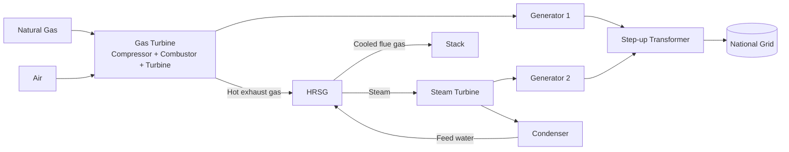
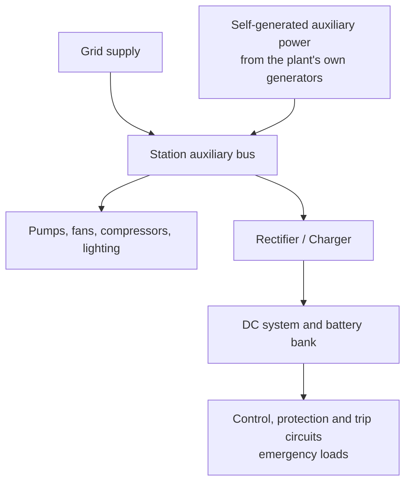

# Industrial Visit Report
## Ghorashal Power Station, Narsingdi, Bangladesh

**Course:** Power Transmission and Distribution  
**Department of Electrical and Electronic Engineering (DEEE)**  
International University of Business Agriculture and Technology (IUBAT)

---

| | |
|---|---|
| **Prepared by** | M. Shoyab Sadik, B.Sc. in EEE, IUBAT |
| **Date of visit** | 26 August 2025 |
| **Venue** | Ghorashal Power Station, Narsingdi |
| **Course instructor** | Dr. Bishwajit Saha, Professor and OBE Coordinator |
| **Organized by** | Department of Electrical and Electronic Engineering (DEEE), IUBAT |
| **Focus areas** | CCPP, HRSG, gas turbine operation, SCADA/HMI, auxiliary power, switchgear and protection, transmission switchyard |

---

## Table of Contents

1. [Abstract](#1-abstract)
2. [Introduction](#2-introduction)
3. [Objectives](#3-objectives)
4. [About Ghorashal Power Station](#4-about-ghorashal-power-station)
5. [Technical Background and Learning Topics](#5-technical-background-and-learning-topics)
   - [5.1 Combined Cycle Power Plant (CCPP)](#51-combined-cycle-power-plant-ccpp)
   - [5.2 HRSG and flue gas heat recovery](#52-hrsg-and-flue-gas-heat-recovery)
   - [5.3 Gas turbine operation: IGV and FSNL](#53-gas-turbine-operation-igv-and-fsnl)
   - [5.4 Load types and spinning reserve](#54-load-types-and-spinning-reserve)
   - [5.5 Balance of Plant (BOP) and gas supply](#55-balance-of-plant-bop-and-gas-supply)
   - [5.6 Three-phase balanced load, MW and MVAR](#56-three-phase-balanced-load-mw-and-mvar)
   - [5.7 Monitoring and control: HMI, SCADA and DCS](#57-monitoring-and-control-hmi-scada-and-dcs)
   - [5.8 Protection: VCB, lightning arrester, transformer](#58-protection-vcb-lightning-arrester-and-transformer)
   - [5.9 Auxiliary power systems](#59-auxiliary-power-systems)
6. [Site Observations](#6-site-observations)
   - [6.1 Generation hall](#61-generation-hall-turbines-and-generators)
   - [6.2 Auxiliary systems and maintenance](#62-auxiliary-systems-and-maintenance)
   - [6.3 Control room](#63-control-room-and-monitoring)
   - [6.4 Switchyard and transmission](#64-switchyard-and-power-transmission)
7. [Safety Practices](#7-safety-practices)
8. [Theory vs. Practice](#8-theory-vs-practice)
9. [Key Takeaways](#9-key-takeaways)
10. [Conclusion](#10-conclusion)
11. [Acknowledgment](#11-acknowledgment)
12. [Glossary](#12-glossary)

---

## 1. Abstract

This report documents an industrial visit to **Ghorashal Power Station** undertaken on 26 August 2025 by students of the Power Transmission and Distribution course, Department of EEE, IUBAT. The visit linked classroom theory with real power-generation practice. It covered the combined-cycle process (gas turbine, HRSG, steam turbine), plant control through HMI/SCADA, auxiliary and backup power arrangements, circuit protection, and the high-voltage switchyard that connects the station to the national grid.

---

## 2. Introduction

On 26 August 2025, students of the Power Transmission and Distribution course from the Department of Electrical and Electronic Engineering (DEEE) at IUBAT visited Ghorashal Power Station. The visit was organized under the guidance of Dr. Bishwajit Saha, Professor and OBE Coordinator. Its primary purpose was to bridge the gap between theoretical classroom knowledge and practical industrial applications in power generation, transmission and distribution.

Students followed the electricity generation chain from fuel (primarily natural gas) through turbines and generators, auxiliary-system maintenance and safety protocols, to the transmission of power into the national grid through high-voltage substations.

   
  <em>Figure 1: Group photo of IUBAT DEEE students and faculty at Ghorashal Power Station</em>

---

## 3. Objectives

1. Understand the complete process of electricity generation using gas turbines and steam turbines.
2. Observe the operation and maintenance of auxiliary systems that support the main generating units.
3. Learn how natural gas is used as fuel for power generation and how the combustion systems work.
4. Study the safety factors, protection systems and control mechanisms of a large power plant.
5. Examine the high-voltage transmission infrastructure (transformers, insulators, switchgear) that connects the plant to the national grid.
6. Gain practical exposure to the control room operations and monitoring systems of a modern thermal power station.

---

## 4. About Ghorashal Power Station

Ghorashal Power Station is a major thermal power plant in the Narsingdi district of Bangladesh. It operates under the Bangladesh Power Development Board (BPDB) and contributes significantly to the country's electricity supply. The plant uses natural gas as its primary fuel and has been expanded over the years with multiple units of varying capacities, combining conventional steam-turbine technology with more efficient combined-cycle systems.

The station includes large generators, extensive auxiliary equipment, cooling systems, fuel-handling facilities and a comprehensive high-voltage switchyard for power evacuation. During the visit the group observed both the generation hall and the outdoor switchyard areas.

   
  <em>Figure 2: Exterior view of Ghorashal Power Station showing chimneys and industrial structures</em>

---

## 5. Technical Background and Learning Topics

> **Scope note:** This section lists the topics covered during the visit and explains each one using standard power-engineering principles. Equipment ratings and exact plant parameters are intentionally not quoted, since they were not recorded during the visit.

### 5.1 Combined Cycle Power Plant (CCPP)

A CCPP generates electricity in **two stages from a single fuel input**:

1. **Topping cycle (Brayton):** A gas turbine burns natural gas and drives a generator.
2. **Bottoming cycle (Rankine):** The hot exhaust gas from the gas turbine passes through a **Heat Recovery Steam Generator (HRSG)**, which produces steam. The steam drives a steam turbine and a second generator.

Recovering heat that a simple-cycle gas turbine would discard makes the overall efficiency considerably higher.

<em>Figure A: Simplified energy flow of a combined cycle power plant (schematic)</em>

### 5.2 HRSG and flue gas heat recovery

The **HRSG** is a large heat exchanger placed in the gas turbine exhaust path. No fuel is burned in it in a basic configuration; it only extracts heat from the exhaust. Its main sections are:

| Section | Function |
|---|---|
| **Economizer** | Pre-heats feed water using the coolest part of the flue gas |
| **Evaporator (drum)** | Converts water into saturated steam |
| **Superheater** | Raises steam temperature above saturation for the steam turbine |

**Flue gas** is the exhaust gas leaving the gas turbine. By extracting its heat in the HRSG before it leaves through the stack, the plant turns waste heat into additional electrical output and lowers the thermal load released to the atmosphere.

### 5.3 Gas turbine operation: IGV and FSNL

**Inlet Guide Vane (IGV).** The IGV is a set of adjustable vanes at the compressor inlet. By changing their angle, the control system regulates the **mass flow of air** entering the compressor. This helps with:
- stable start-up and avoiding compressor surge,
- part-load operation, where reduced airflow keeps exhaust temperature high so the HRSG still receives useful heat.

**Full Speed No Load (FSNL).** FSNL is the state in which the gas turbine runs at **rated speed with the generator excited but not delivering power to the grid**. For a 50 Hz system with a 2-pole generator:

$$N_s = \frac{120 f}{P} = \frac{120 \times 50}{2} = 3000\ \text{RPM}$$

From FSNL, the unit is **synchronized** to the grid (matching voltage, frequency, phase sequence and phase angle) and then loaded.

### 5.4 Load types and spinning reserve

| Term | Meaning |
|---|---|
| **Base load** | Continuous, steady demand served by units that run most of the time at high output |
| **Peak load** | Short-duration demand peaks (for example, evening hours) served by units that can start and ramp quickly |
| **Spinning reserve** | Generating capacity that is already synchronized to the grid and partly loaded, ready to increase output quickly if demand rises or another unit trips |

### 5.5 Balance of Plant (BOP) and gas supply

**BOP** covers every system needed to run the plant other than the main turbine-generator sets and HRSG, for example:

- fuel gas supply and conditioning
- water treatment and feed water
- cooling water and heat rejection
- compressed air
- lubrication systems
- electrical auxiliaries and station services

**Gas supply and fuel management** typically involves pressure regulation, metering, filtration and conditioning, with isolation and trip valves that cut off fuel automatically under abnormal conditions (for example, flame loss or a gas leak).

### 5.6 Three-phase balanced load, MW and MVAR

In a **balanced** three-phase system, all phases carry equal current magnitude, displaced by 120°. Importance:

- the neutral current is ideally zero,
- total instantaneous power is constant, giving smoother torque on rotating machines,
- generators are protected from heating caused by negative-sequence currents.

Power relations used in plant operation:

$$P = \sqrt{3}\, V_L I_L \cos\phi \quad (\text{MW})$$

$$Q = \sqrt{3}\, V_L I_L \sin\phi \quad (\text{MVAR})$$

$$S = \sqrt{P^2 + Q^2} \quad (\text{MVA})$$

**MW** is real power that does useful work, and **MVAR** is reactive power that supports voltage and magnetic fields. Operators monitor both because generators and transformers are limited by apparent power (MVA).

### 5.7 Monitoring and control: HMI, SCADA and DCS

| System | Role |
|---|---|
| **HMI** (Human–Machine Interface) | Screens and panels through which operators view process values and issue commands |
| **SCADA** | Supervisory Control and Data Acquisition: remote monitoring, control and data logging across the plant and substation |
| **DCS** | Distributed Control System: runs continuous process control loops (temperature, pressure, flow, speed) across many controllers |

Together they provide real-time generation data, alarms, trends, grid-connection status and power management for the control room.

### 5.8 Protection: VCB, lightning arrester and transformer

**Vacuum Circuit Breaker (VCB).** Contacts open inside a sealed vacuum interrupter. The arc that forms is sustained only by vaporized contact metal, and it is extinguished at the first current zero because the vacuum recovers its dielectric strength extremely quickly. VCBs are widely used in medium-voltage switchgear for their reliability and low maintenance.

**Lightning arrester (surge arrester).** Connected between line and earth, it presents a very high impedance at normal voltage and conducts the surge current to earth when a lightning or switching overvoltage appears, then returns to its high-impedance state. It protects transformers and other expensive equipment from insulation damage.

**Transformer cooling and protection.** Typical arrangements include:

| Cooling method | Description |
|---|---|
| ONAN | Oil Natural, Air Natural: natural circulation, passive cooling |
| ONAF | Oil Natural, Air Forced: fans assist air cooling |
| OFAF | Oil Forced, Air Forced: pumps and fans for large units |

Typical protection devices include the Buchholz relay (gas/oil surge detection), winding and oil temperature indicators, pressure relief devices, oil-level gauges, and electrical differential and overcurrent protection.

### 5.9 Auxiliary power systems

A power plant needs its own electricity to run pumps, fans, compressors, control systems and lighting. Continuous operation is maintained by layered sources:

<em>Figure B: Layered auxiliary power concept (schematic)</em>

| Source | Purpose |
|---|---|
| **Grid supply** | Powers auxiliaries when units are down, for example during start-up |
| **Self-generated auxiliary power** | Once running, the plant supplies its own auxiliary load |
| **DC backup (battery)** | Keeps control, protection and emergency systems alive during an AC outage |

---

## 6. Site Observations

### 6.1 Generation hall: turbines and generators

Fuel is combusted to produce high-temperature, high-pressure gas (or steam in steam-turbine units). The gas expands across the turbine blades and rotates the shaft, which is coupled to a **synchronous generator** that converts mechanical energy into electrical energy by electromagnetic induction.

The group closely examined **Generator Unit No. 2**, a large **hydrogen-cooled** generator, marked with clear safety signage ("DANGER! HYDROGEN GAS"). Hydrogen is used because of its excellent heat transfer and low density, which reduces windage losses. Reliable sealing and continuous purity and pressure monitoring are essential to prevent leakage.

   
  <em>Figure 3: Generator Unit No. 2 (hydrogen-cooled) inside the power plant hall</em>

   
  <em>Figure 4: Wider view of the generator hall showing Unit No. 2 and associated piping and structures</em>

### 6.2 Auxiliary systems and maintenance

Reliable operation depends on numerous auxiliary systems: cooling water, lubricating oil, fuel gas conditioning, compressed air, pumps and heat exchangers. A failure in any of these can force a unit shutdown or reduce efficiency, so regular inspection, corrosion control and safety interlocks are central to the maintenance regime. Large storage tanks used for fuel or process fluids were visible on site.

   
  <em>Figure 5: Large storage tank and associated plant infrastructure</em>

### 6.3 Control room and monitoring

The control room is the nerve center of the station. Mimic panels and control desks cover boiler control, turbine control, generator control, station services and gas systems. Meters, switches, indicators and schematic diagrams allow operators to monitor and control the plant in real time. Modern plants increasingly rely on digital HMI/SCADA/DCS, while hard-wired panels still give clear visibility of overall process flow.

   
  <em>Figure 6: Main control room showing boiler, turbine and generator control desks</em>

<table align="center">
  <tr>
    <td align="center"> <em>Figure 7: Control panels with switches, meters and schematic diagrams</em></td>
    <td align="center"> <em>Figure 8: Students examining the Panel of Station Services</em></td>
  </tr>
</table>

### 6.4 Switchyard and power transmission

After generation, power is stepped up by power transformers and transmitted to the national grid. The outdoor switchyard contains circuit breakers, disconnectors, current and voltage transformers, surge arresters, and long strings of suspension and post insulators. Students walked through the switchyard under supervision and observed the busbar arrangements, the porcelain and composite insulators that provide electrical isolation, and the protective relay systems that isolate faults. Seeing the link between generator terminals and the transmission network reinforced the course theory.

   
  <em>Figure 9: Students walking through the high-voltage switchyard</em>

<table align="center">
  <tr>
    <td align="center"> <em>Figure 10: High-voltage post insulators and support structures</em></td>
    <td align="center"> <em>Figure 11: High-voltage equipment and bus arrangements</em></td>
  </tr>
</table>

   
  <em>Figure 12: Students and faculty discussing equipment in the switchyard</em>

   
  <em>Figure 13: Interactive discussion session with plant personnel</em>

   
  <em>Figure 14: Students examining overhead transmission structures and gantries</em>

---

## 7. Safety Practices

- **Hydrogen cooling:** continuous monitoring of gas purity and pressure, with explosion-proof equipment.
- **High-voltage areas:** clearly demarcated, with only authorized personnel near energized equipment.
- **Control and protection:** interlocking, trip systems and alarm panels protect equipment and personnel.
- **Fire and emergency:** fire detection and suppression, emergency shutdown procedures and strictly enforced PPE.
- **Signage:** clear warning signs (for example "DANGER! HYDROGEN GAS") and bilingual labeling.
- **Fuel gas:** leak detection, flame monitoring and automatic fuel cut-off under abnormal conditions.

---

## 8. Theory vs. Practice

| Classroom concept | Where it appeared on site |
|---|---|
| Synchronous generator and electromagnetic induction | Hydrogen-cooled Generator Unit No. 2 |
| Brayton and Rankine cycles | Gas turbine + HRSG + steam turbine (CCPP) |
| Real and reactive power (MW, MVAR, MVA) | Control room generation and reactive-power monitoring |
| Protection and switchgear | VCBs, relays, surge arresters, transformer protection |
| Transmission and substation layout | Outdoor switchyard, busbars, insulators, gantries |
| Reliability of supply | Grid, self-generated and DC backup auxiliary power |

---

## 9. Key Takeaways

- Electricity generation is a coordinated process of fuel, thermodynamics, rotating machinery and electromagnetic conversion.
- Combined-cycle plants raise efficiency by recovering exhaust heat through the HRSG.
- Auxiliary systems are as critical as the main units; plant reliability depends on their continuous availability, including DC backup.
- Safety culture, from hydrogen handling to high-voltage clearances, is non-negotiable.
- Control rooms integrate operators with HMI/SCADA/DCS instrumentation to hold stable, efficient operation.
- The switchyard is the vital link that delivers generated power to consumers across the national grid.

---

## 10. Conclusion

The industrial visit to Ghorashal Power Station on 26 August 2025 was a valuable educational experience. By observing real turbines, generators, control systems, safety arrangements and high-voltage equipment, students gained a concrete understanding of topics previously studied only in textbooks and lectures.

The visit reinforced the interdisciplinary nature of power engineering: thermodynamics, electrical machines, protection, instrumentation and safety all work together in a modern power plant. It also showed how MW, MVAR, turbines, generators, transformers, protection, control systems and grid operation connect in a real station, and it gave students a clear appreciation of the scale of infrastructure that keeps the lights on across Bangladesh.

---

## 11. Acknowledgment

Sincere gratitude to **Dr. Bishwajit Saha**, Professor and OBE Coordinator, for organizing and guiding this industrial visit. Thanks also to the authorities and technical staff of Ghorashal Power Station for granting access and sharing their practical knowledge, and to the **Department of Electrical and Electronic Engineering (DEEE), IUBAT**, for facilitating this learning opportunity.

---

## 12. Glossary

| Term | Full form / meaning |
|---|---|
| BOP | Balance of Plant |
| BPDB | Bangladesh Power Development Board |
| CCPP | Combined Cycle Power Plant |
| DCS | Distributed Control System |
| FSNL | Full Speed No Load |
| HMI | Human–Machine Interface |
| HRSG | Heat Recovery Steam Generator |
| IGV | Inlet Guide Vane |
| MVAR | Mega Volt-Ampere Reactive (reactive power) |
| MW | Megawatt (real power) |
| PPE | Personal Protective Equipment |
| SCADA | Supervisory Control and Data Acquisition |
| VCB | Vacuum Circuit Breaker |

---

*Learning • Exploring • Connecting*

Department of Electrical and Electronic Engineering, IUBAT

